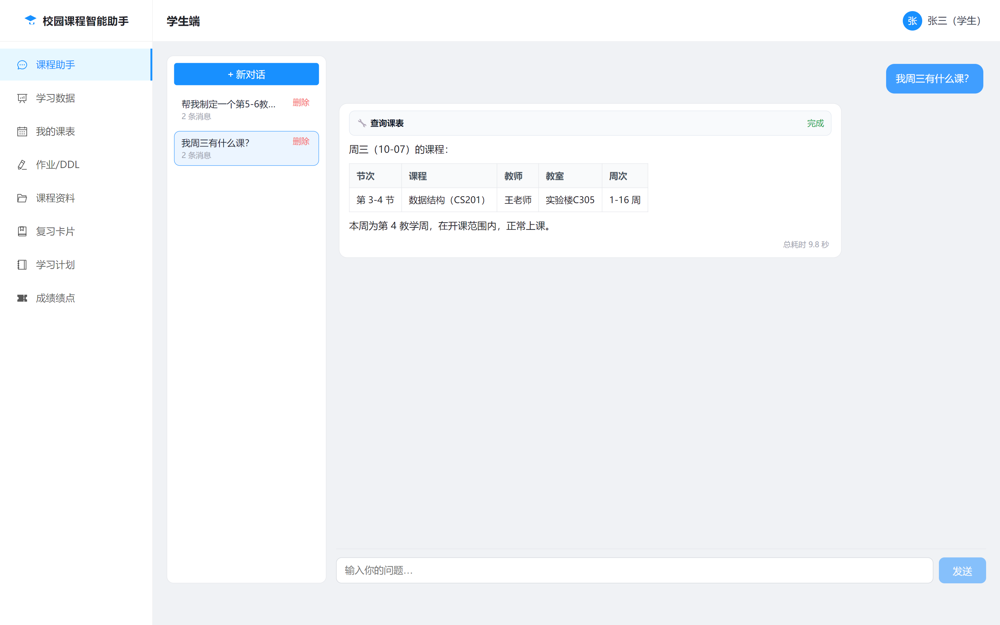
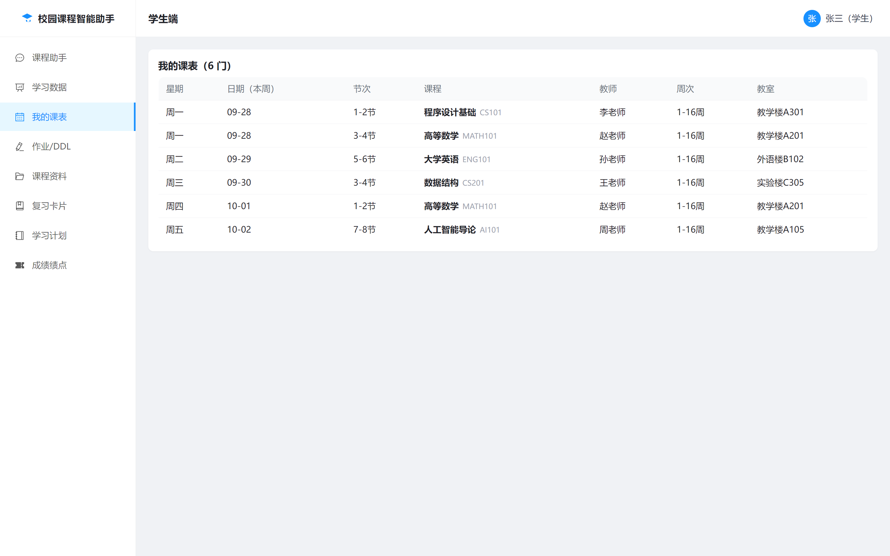
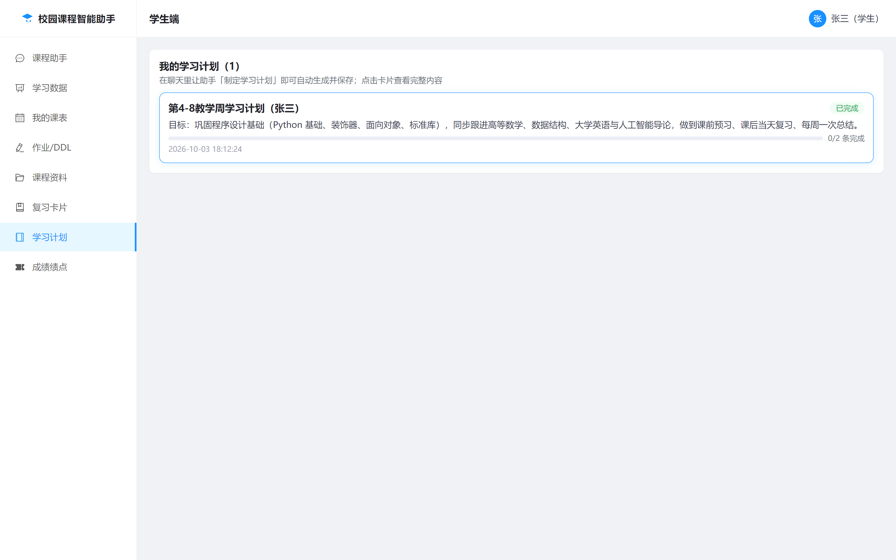
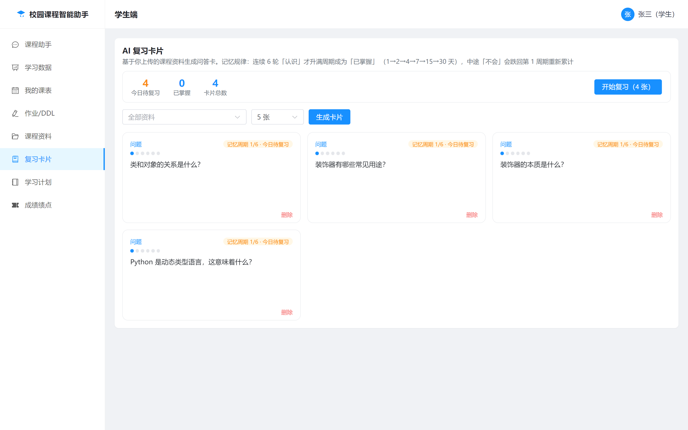
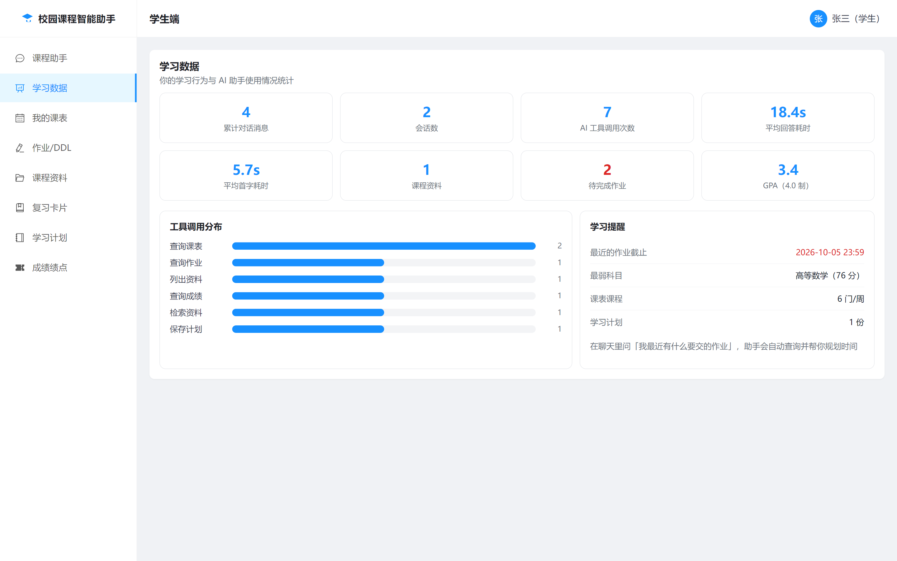
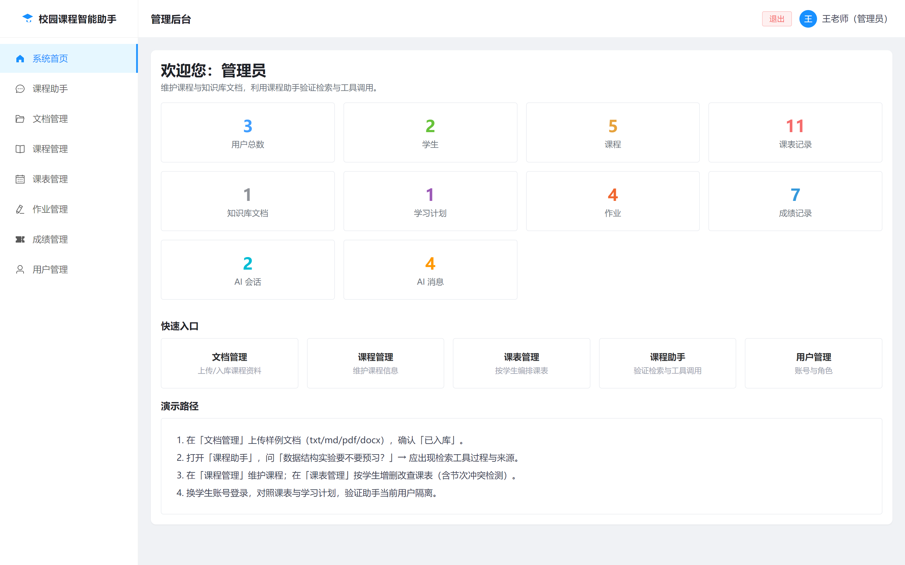
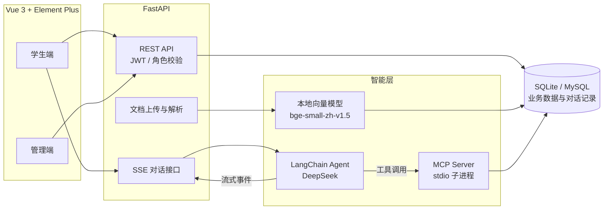

# 校园课程智能助手（course-agent）

面向学生的全栈校园课程助手。系统将课程业务封装为 MCP 工具，由 LangChain Agent 调度 DeepSeek 完成课表查询、资料问答和学习计划生成；前端提供流式对话、课程管理、作业 DDL、成绩绩点、复习卡片等完整工作台。


## 核心能力

- **真实数据查询**：Agent 通过 MCP 工具读取当前学生的课表、作业和成绩，而不是由模型凭空生成。
- **个人知识库 RAG**：上传 PDF、DOCX、TXT、Markdown 后自动切片、向量化；检索结果强制按当前用户隔离，并在回答中保留来源。
- **可观测的流式对话**：FastAPI 以 SSE 推送工具开始、工具结束、文本增量和完成事件，前端可展示完整调用过程。
- **学习闭环**：课程助手不仅回答问题，还能生成可勾选的学习计划，并基于资料生成带间隔重复机制的复习卡片。
- **学生/管理员双端**：学生维护自己的课程数据；管理员维护课程、课表、作业、成绩、文档与用户。

## 项目预览

| 课程助手 | 我的课表 |
| --- | --- |
|  |  |
| **学习计划** | **复习卡片** |
|  |  |
| **学习数据** | **管理后台** |
|  |  |

## 功能模块

### 学生端

| 模块 | 主要能力 |
| --- | --- |
| 课程助手 | SSE 流式回复、多轮会话、Markdown/表格渲染、MCP 工具调用卡片、RAG 来源展示、会话历史 |
| 学习数据 | 会话数、消息数、工具调用分布、平均首字/总耗时、文档数、计划数、待办作业与 GPA 概览 |
| 我的课表 | 按教学周展示课程、节次、地点、教师和本周日期 |
| 作业 / DDL | 按截止时间查看作业、逾期标记、完成状态切换 |
| 课程资料 | 上传 PDF/DOCX/TXT/MD，自动抽取文本、切片、向量化并写入个人知识库 |
| 学习计划 | 查看、编辑、删除计划；AI 生成的目标可拆成具体条目并逐项打卡 |
| 复习卡片 | 从已入库资料生成问答卡，按认识/模糊/忘记进行复习，支持撤销最近一次打卡 |
| 成绩绩点 | 展示百分制成绩、4.0 绩点、学分加权 GPA、平均分与最弱科目 |

### 管理端

| 模块 | 主要能力 |
| --- | --- |
| 系统首页 | 用户、课程、课表、文档、计划、作业、成绩、会话等统计 |
| 课程助手 | 与同一 Agent 交互，用于验证知识库检索和工具调用 |
| 文档管理 | 查看全部文档、预览文本、重新入库、删除 |
| 课程管理 | 新增、编辑、删除课程 |
| 课表管理 | 按学生和星期筛选，新增/编辑课表，检测节次冲突 |
| 作业管理 | 按学生和状态筛选，发布、编辑、删除作业 |
| 成绩管理 | 按学生录入、覆盖、删除百分制成绩 |
| 用户管理 | 创建/编辑学生和管理员、重置密码、删除账号 |

### Agent 工具

MCP Server 以 `stdio` 子进程方式随对话启动，当前提供 6 个工具：

| 工具 | 用途 |
| --- | --- |
| `get_my_schedule` | 查询当前学生的完整课表 |
| `search_course_documents` | 在个人资料中做语义检索并返回来源片段 |
| `list_my_documents` | 查看当前学生已上传的资料 |
| `save_study_plan` | 保存学习计划及可勾选任务 |
| `get_upcoming_assignments` | 查询未来若干天内及已逾期的未完成作业 |
| `get_my_scores` | 查询课程成绩、加权 GPA 和最弱科目 |

## 系统架构



### 关键设计

**用户身份强制绑定**

MCP 工具本身接收 `user_id`，但 Agent 侧通过 `UserBoundTool` 在执行前将模型传入的任何值覆盖为当前登录用户。即使模型误传或用户试图注入其他学号，也无法查询他人数据；普通 REST 接口同样按当前 JWT 用户过滤个人资源。

**个人 RAG 管线**

- 支持 `.pdf`、`.docx`、`.txt`、`.md`，单文件上限 10 MB。
- 按段落聚合为约 500 字的切片，使用 `BAAI/bge-small-zh-v1.5` 在本地生成向量。
- 向量以 JSON 文本保存在 `document_chunks` 中，检索时先按 `user_id` 过滤，再计算余弦相似度并返回 Top-K。
- Agent 被约束为仅依据检索片段回答；资料不足时明确回复“资料中未找到”。

**流式对话与可观测性**

`POST /api/chat` 返回 `text/event-stream`，前端依次处理 `tool_start`、`tool_end`、`text`、`done` 和 `error` 事件。每次回答会记录工具输入输出摘要、检索来源、首字耗时和总耗时，供学习数据页及管理后台统计。

**上下文与日期感知**

每个会话会携带最近 20 条消息作为上下文。系统提示中注入当前时间、星期和教学周，Agent 会先将“今天/明天/下周一”等表达换算为具体日期，再结合课表的星期与周次范围判断是否有课。

**复习间隔**

复习卡片使用 1-6 级 Leitner 盒模型。选择“认识”会升盒并延长下次复习间隔，选择“模糊”在次日再次出现，“忘记”则回到第 1 盒；最近一次复习可撤销。

## 技术栈

| 层级 | 技术 |
| --- | --- |
| 前端 | Vue 3、Vite、Element Plus、Vue Router、Marked、DOMPurify |
| 后端 | FastAPI、SQLAlchemy 2.0、Pydantic 2、PyJWT |
| Agent | LangChain、DeepSeek OpenAI 兼容接口 |
| 工具协议 | MCP / FastMCP、`langchain-mcp-adapters` |
| RAG | FastEmbed、`BAAI/bge-small-zh-v1.5`、余弦相似度 |
| 数据库 | SQLite（开发默认）/ MySQL 8（Docker 配置） |
| 部署 | Docker Compose、Nginx、Uvicorn |

## 项目结构

```text
course-agent/
├── backend/
│   ├── app/
│   │   ├── api/            # 认证、聊天、文档、计划、作业、成绩、管理端接口
│   │   ├── agent/          # Agent 组装、用户绑定、系统提示
│   │   ├── core/           # 密码与 JWT 鉴权
│   │   ├── mcp/            # MCP 工具服务器
│   │   ├── models/         # SQLAlchemy 数据模型
│   │   ├── rag/            # 文档切片、向量化与检索
│   │   ├── config.py       # 环境配置
│   │   ├── database.py     # 数据库连接
│   │   ├── main.py         # FastAPI 入口
│   │   └── seed.py         # 建表与演示数据
│   ├── data/
│   │   ├── sample_docs/    # 示例课程资料
│   │   └── fastembed_cache/# 本地向量模型缓存
│   └── scripts/            # MCP / RAG 自检脚本
├── frontend/
│   └── src/
│       ├── views/          # 登录、学生端、管理端页面
│       ├── components/     # 对话、课表、计划等通用组件
│       ├── router/         # 路由与角色守卫
│       └── api.js          # REST 与 SSE 请求封装
├── docs/                   # 需求、数据模型与界面截图
├── docker-compose.yml
└── README.md
```

## 快速开始

### 环境要求

- Python 3.11+
- Node.js 20.19+ 或 22.12+、npm
- DeepSeek API Key（聊天与复习卡片生成需要）
- MySQL 8（仅 Docker Compose 方案需要；本地默认使用 SQLite）

### 方式一：本地开发（默认 SQLite）

先创建 `backend/.env`：

```dotenv
DEEPSEEK_API_KEY=sk-...
JWT_SECRET=replace-with-a-random-secret
SEMESTER_START=2026-09-07
```

启动后端：

```powershell
cd backend
python -m venv .venv
.\.venv\Scripts\Activate.ps1
python -m pip install -r requirements.txt
python -m app.seed
python -m uvicorn app.main:app --reload --port 8000
```

另开一个终端启动前端：

```powershell
cd frontend
npm ci
npm run dev
```

访问地址：

- 前端：<http://localhost:5173>
- 后端接口文档：<http://127.0.0.1:8000/docs>
- 健康检查：<http://127.0.0.1:8000/api/health>

初始化样例知识库（建库后执行一次，示例讲义才会被切片并写入向量）：

```powershell
cd backend
python -m scripts.self_check
```

> `python -m app.seed` 会删除并重建用户、课程、课表、计划和文档等基础数据，再写入演示内容，建议只在空开发库执行一次。首次使用 RAG 时如果本地没有模型缓存，系统会自动下载 `bge-small-zh-v1.5`，需要访问模型源。

### 方式二：Docker Compose（复用宿主机 MySQL）

Docker 方案的后端容器连接宿主机的 MySQL 8，上传文件保存在命名卷 `uploads` 中。

1. 在项目根目录创建 `.env`：

```dotenv
DEEPSEEK_API_KEY=sk-...
JWT_SECRET=replace-with-a-random-secret
SEMESTER_START=2026-09-07
```

2. 在宿主机创建数据库和容器访问账号：

```powershell
mysql -uroot -p -e "CREATE DATABASE IF NOT EXISTS course_agent CHARACTER SET utf8mb4; CREATE USER IF NOT EXISTS 'course'@'%' IDENTIFIED BY '123456'; GRANT ALL PRIVILEGES ON course_agent.* TO 'course'@'%'; FLUSH PRIVILEGES;"
```

3. 构建并启动：

```powershell
docker compose up -d --build
docker compose exec backend python -m app.seed
docker compose exec backend python -m scripts.self_check
```

4. 访问 <http://localhost:5173>。

容器模式下，Nginx 将 `/api` 反向代理到后端，因此前端无需额外配置接口地址。后端服务没有直接映射到宿主机端口；排查问题可运行 `docker compose logs -f backend`。

### 演示账号

| 角色 | 用户名 | 密码 | 说明 |
| --- | --- | --- | --- |
| 学生 | `student01` | `student01` | 含课表、作业、成绩和示例文档 |
| 学生 | `student02` | `student02` | 用于验证个人数据隔离 |
| 管理员 | `admin01` | `admin01` | 可访问全部管理模块 |

## 配置说明

本地开发读取 `backend/.env`；Docker Compose 从项目根目录 `.env` 注入部分变量。常用配置如下：

| 变量 | 默认值 / 示例 | 说明 |
| --- | --- | --- |
| `DEEPSEEK_API_KEY` | `sk-...` | DeepSeek API Key，对话和卡片生成必需 |
| `DEEPSEEK_BASE_URL` | `https://api.deepseek.com` | DeepSeek OpenAI 兼容接口地址 |
| `DEEPSEEK_MODEL` | `deepseek-chat` | 对话模型 |
| `DATABASE_URL` | `sqlite:///./course_agent.db` | SQLAlchemy 连接串；Docker 中注入 MySQL 地址 |
| `DATABASE_NAME` | 空 | 可选，覆盖连接串中的数据库名 |
| `SEMESTER_START` | `2026-09-07` | 学期第一周周一，用于计算当前教学周 |
| `JWT_SECRET` | 开发默认值 | JWT 签名密钥，部署时必须更换 |
| `ACCESS_TOKEN_EXPIRE_MINUTES` | `1440` | 登录令牌有效期，默认 24 小时 |
| `FASTEMBED_CACHE_PATH` | `backend/data/fastembed_cache` | 可选，覆盖本地向量模型缓存目录 |

数据库使用 MySQL 时，可在 `backend/.env` 中配置：

```dotenv
DATABASE_URL=mysql+pymysql://用户名:密码@127.0.0.1:3306/course_agent?charset=utf8mb4
```

## 接口概览

所有接口统一挂在 `/api` 下：

| 前缀 | 说明 |
| --- | --- |
| `/auth` | 登录、注册、当前用户 |
| `/chat` | SSE 流式 Agent 对话 |
| `/conversations` | 会话与消息历史 |
| `/schedules` | 当前学生课表 |
| `/documents` | 个人课程资料上传与列表 |
| `/plans` | 学习计划及任务条目 |
| `/flashcards` | 复习卡片生成、复习和撤销 |
| `/assignments`、`/scores`、`/stats` | 作业、成绩与学习统计 |
| `/admin/*` | 管理端接口，要求管理员角色 |

完整的请求与响应结构可在 FastAPI Swagger 页面查看。

## 自检与构建

后端自检脚本不调用 DeepSeek：

```powershell
cd backend
python -m scripts.self_check
python -m scripts.mcp_check
```

- `self_check`：直接调用课表/计划工具，并对示例讲义执行切片、向量化和检索，同时验证跨用户检索隔离。
- `mcp_check`：启动 MCP stdio 客户端，验证 6 个工具可加载、用户绑定生效。该脚本会写入一条“MCP自检计划”，建议在开发库执行。

前端构建检查：

```powershell
cd frontend
npm run build
```

## 部署说明

当前版本面向课程设计和本地演示：

- 后端启动时通过 `Base.metadata.create_all` 自动建表，尚未接入 Alembic 迁移。
- 默认 CORS 只允许 `localhost:5173` 和 `127.0.0.1:5173`，正式部署需调整。
- 默认 JWT 密钥仅供开发使用，生产环境必须通过环境变量覆盖。
- 对话与资料问答依赖外部 DeepSeek 服务；文档向量化模型在本地运行。
- 目前以脚本自检和前端构建作为验证手段，尚未建立完整的自动化测试套件。

## 文档

- [需求说明](docs/requirements.md)
- [数据模型设计](docs/data-model.md)

需求与数据模型文档保留了项目早期设计，当前实现已扩展复习卡片、对话记录、作业和成绩等模块；实际字段以 `backend/app/models` 为准。

## License

本项目基于 [MIT License](LICENSE) 开源。
